# Facet

> 🌐 [English](README.md) · [Français](README.fr.md) · [Deutsch](README.de.md) · **Italiano** · [Español](README.es.md) · [Português](README.pt.md) · [简体中文](README.zh.md)

Facet è un motore locale di analisi e selezione delle foto. Assegna a ogni immagine un punteggio su 9 dimensioni — dalla qualità estetica alla nitidezza dei volti — e ti permette poi di sfogliare, selezionare e organizzare attraverso una galleria web. Tutto viene eseguito sulla tua macchina; nessun cloud, account o chiave API.


<p align="center">
  
</p>

## Come funziona

1. **Scansione** — Indica a Facet una cartella di foto. Ogni immagine viene analizzata per qualità, composizione e volti. Supporta JPEG, HEIF/HEIC, 10 formati RAW, JPEG XL, AVIF, PNG, WebP, TIFF e altri — vedi [tipi di file supportati](docs/it/README.md#tipi-di-file-supportati).
2. **Sfogliare** — Apri la galleria web per esplorare la tua libreria con filtri, ricerca e più modalità di visualizzazione.
3. **Selezione** — Facet rileva le raffiche, segnala gli occhi chiusi, raggruppa le foto simili e mette in evidenza le migliori scelte. I bracket di esposizione e le serie panorama/HDR vengono riconosciuti e mantenuti interi anziché smembrati dalla selezione.

La GPU viene rilevata automaticamente ed è opzionale. Facet funziona solo su CPU oppure con un massimo di 24 GB di VRAM.

## Funzionalità

### Punteggio

A ogni foto viene assegnato un punteggio su 9 dimensioni: qualità estetica, composizione, qualità del volto, nitidezza degli occhi, nitidezza tecnica, colore, esposizione, salienza del soggetto e gamma dinamica. Le foto vengono categorizzate per contenuto (ritratto, paesaggio, macro, street, ecc. — oltre 30 categorie) e valutate con pesi specifici per categoria. Un filtro **Migliori scelte** classifica la libreria in base a un punteggio combinato.

Passa il puntatore su una foto per vedere il dettaglio del punteggio e i dati EXIF nel pannello laterale della galleria, oppure passa a un fumetto al passaggio che mostra a colpo d'occhio i punteggi principali.

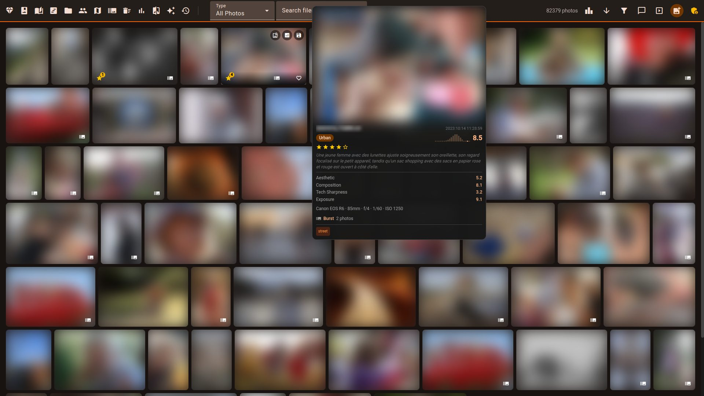

### Selezione

- **Rilevamento raffiche** — raggruppa gli scatti in rapida successione e seleziona automaticamente il migliore in base a nitidezza, qualità e rilevamento degli occhi chiusi
- **Protezione delle serie** — i bracket di esposizione, i panorami e i panorami HDR (`--detect-sequences` / `--detect-panoramas`) vengono riconosciuti come serie; la camera oscura di selezione fa partire ogni scatto di una serie come conservato
- **Gruppi di somiglianza** — trova le foto visivamente simili in tutta la libreria, indipendentemente da quando sono state scattate
- **Scene** — raggruppa una sessione in "scene" cronologiche in base agli intervalli tra gli scatti, così da selezionare nell'ordine del racconto; tocca per contrassegnare e conferma per rifiutare
- **Selezione automatica** — un solo pulsante seleziona un intero ambito (tutti i gruppi, oppure solo raffiche / simili / scene, eventualmente ristretto a un album o a un intervallo di date) con anteprima in dry run, un budget di foto da conservare e un album Highlights facoltativo
- **Selezione automatica da terminale** — `python facet.py --auto-cull [PATH]` mostra la selezione come dry run, `--apply` la scrive e `--copy-keepers DIR` copia le foto conservate (vedi [docs/it/COMMANDS.md](docs/it/COMMANDS.md#selezione-da-terminale))
- **Profili per genere** — i preset sport / matrimonio / concerto / fauna selvatica raccolgono in un'unica scelta severità, budget di foto da conservare, soglia di somiglianza e filtri sui volti
- **Anteprima dell'aspetto modificato** `[Edition]` — renderizza una foto con uno stile darktable con nome dentro la camera oscura di selezione, così selezioni sull'aspetto sviluppato invece che sull'anteprima RAW piatta
- **Primi piani del soggetto** — i gruppi senza volti (fauna selvatica, macro, prodotti) si confrontano tramite una striscia del soggetto ritagliata automaticamente, con badge di nitidezza normalizzati sul gruppo
- **Pulizia degli scarti** — rilevamento zero-shot di file non fotografici superflui (screenshot, documenti, ricevute, meme, diapositive) con una coda di revisione rapida: conserva o rifiuta ogni candidato, oppure rifiutali tutti in una volta
- **Badge per volto nella selezione** — il visualizzatore di selezione mostra badge per ogni volto (occhi aperti/chiusi, espressione, confidenza di rilevamento) invece di un singolo contrassegno di occhi chiusi a livello di foto; i blendshape MediaPipe opzionali affinano la lettura di occhi e sorriso
- **Rilevamento occhi chiusi** — segnala gli scatti con gli occhi chiusi da nascondere o rifiutare con un clic
- **Rilevamento duplicati** — identifica le immagini quasi identiche tramite hashing percettivo

<table><tr>
<td></td>
<td>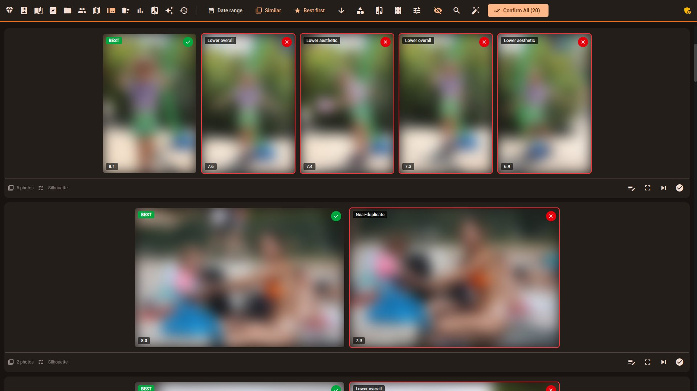</td>
</tr></table>

### Sfogliare

- **Modalità galleria** — mosaico (righe giustificate che preservano le proporzioni) e griglia (schede uniformi con sovrapposizione dei metadati)
- **Filtri** — intervallo di date, tag di contenuto, modello compositivo, fotocamera, obiettivo, persona, cartella, livello di qualità, valutazione a stelle e intervalli di metriche personalizzati
- **Ricerca semantica** — digita una query in linguaggio naturale come "tramonto in spiaggia" e trova le foto corrispondenti tramite embedding e ricerca testuale
- **Cronologia** — browser cronologico con navigazione per anno/mese e scorrimento infinito
- **Mappa** — foto geolocalizzate su una mappa interattiva con clustering dei marcatori
- **Capsule** — presentazioni a tema: viaggi con nomi dei luoghi, collezione dorata, tavolozze stagionali, foto di una persona e altro ancora
- **Cartelle** — sfoglia per struttura di directory con navigazione tramite breadcrumb e foto di copertina
- **Momenti narrativi** — etichette zero-shot di scena/attività (spiaggia, festa, concerto, …) danno un nome alle tue scene, filtrano e ordinano la galleria e alimentano la selezione delle capsule
- **Ricordi** — "Accadde oggi": foto della stessa data negli anni precedenti
- **Presentazione** — modalità a schermo intero con transizioni a tema, concatenamento automatico tra capsule e controlli da tastiera

<table><tr>
<td>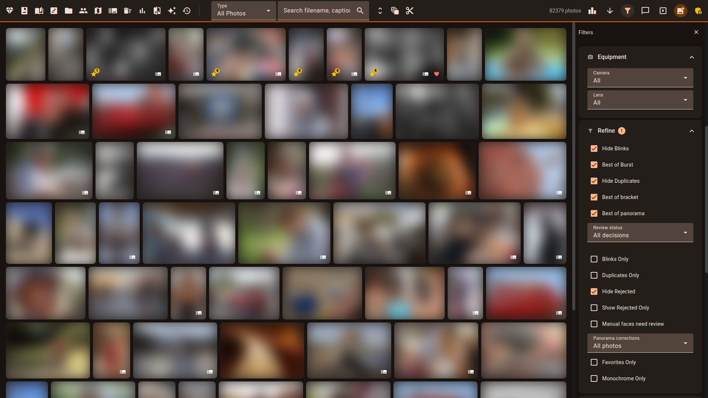</td>
<td>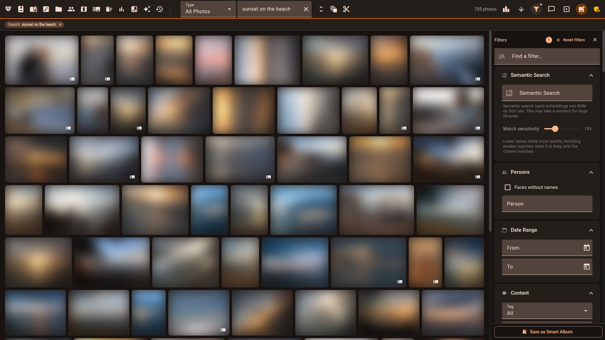</td>
</tr></table>

<details><summary>Barra laterale dei filtri — tutte le sezioni espanse (clicca per visualizzare)</summary>
<p align="center">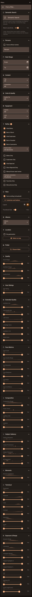</p>
</details>

**Suggerimenti per il flusso di lavoro:**
- La vista **`/timeline`** scende da anni a mesi a giorni; clicca su un giorno per aprire la galleria su quella data.
- La vista **`/capsules`** genera diaporami a tema (viaggi, "Volti di", stagionali, dorate) che puoi salvare come album — la scelta migliore per selezionare gli scatti migliori di un viaggio.
- La galleria nasconde per impostazione predefinita gli occhi chiusi, le raffiche non principali e i duplicati. Quando compare il banner **"N foto nascoste dai filtri attivi"**, clicca su "Mostra tutte" per espandere la vista.

### Organizzare

- **Riconoscimento facciale** — rilevamento automatico dei volti, raggruppamento in persone e rilevamento degli occhi chiusi. Cerca, rinomina, unisci e organizza i cluster di persone dall'interfaccia di gestione. I **suggerimenti di unione** individuano i cluster dall'aspetto simile che potrebbero essere la stessa persona.
- **Album** — raccolte manuali con trascinamento, oppure album intelligenti che si popolano automaticamente da combinazioni di filtri salvate
- **Valutazioni e preferiti** — valutazioni a stelle (1–5), preferiti e contrassegni di rifiuto. Scorri le valutazioni con un solo clic.
- **Tag** — tag di contenuto generati dall'IA con vocabolario configurabile. Clicca su un tag qualsiasi per filtrare la galleria.
- **Operazioni in batch** — selezione multipla con Shift+clic, Ctrl+clic o Ctrl+A (seleziona tutto). Imposta valutazioni, attiva/disattiva i preferiti, contrassegna i rifiuti o aggiungi agli album in blocco — con annullamento di 7 secondi per ogni azione in batch.
- **Priorità alla tastiera** — i tasti freccia navigano la galleria, Invio apre, Spazio seleziona; premi `?` in qualsiasi punto per il riferimento delle scorciatoie.

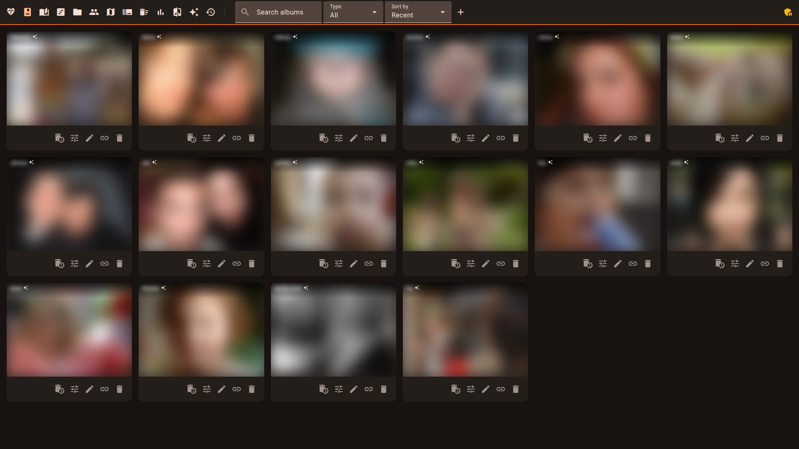

<table><tr>
<td>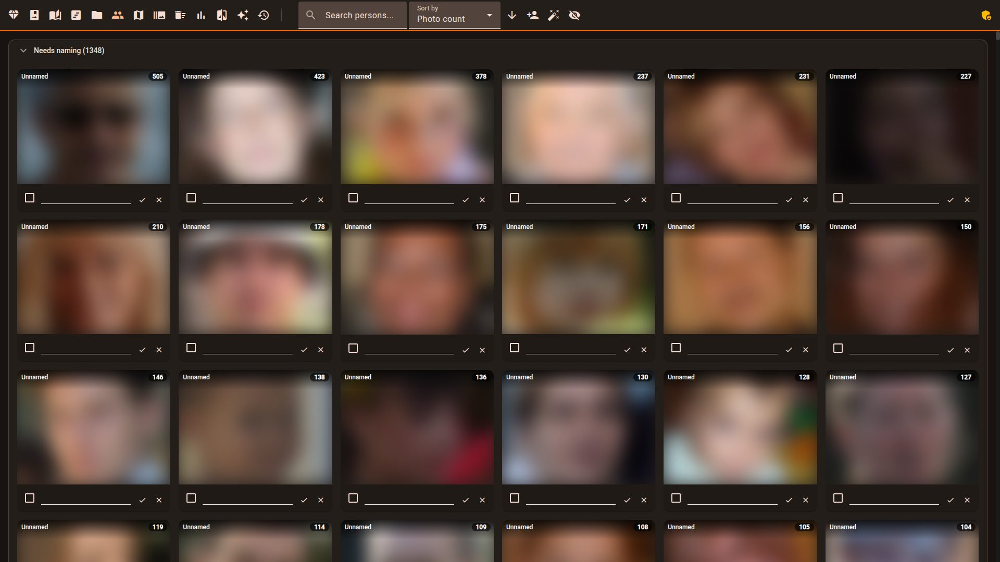</td>
<td>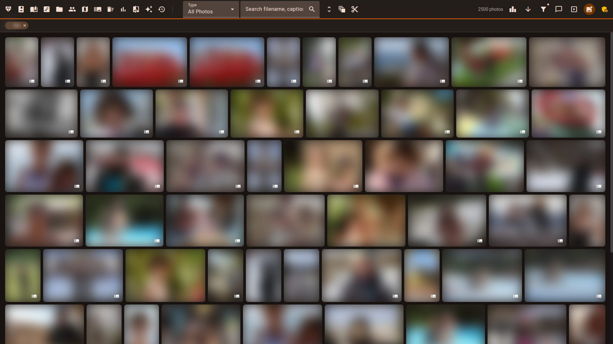</td>
</tr></table>

### Comprendere

- **Statistiche** — dashboard per l'utilizzo dell'attrezzatura, la suddivisione per categoria, la cronologia degli scatti e le correlazioni tra metriche
- **Critica IA** — dettaglio del punteggio che mostra il contributo di ogni metrica; valutazione in linguaggio naturale VLM `[GPU]` `[16gb/24gb]`
- **Regolazione dei pesi** — editor dei pesi per categoria con anteprima del punteggio in tempo reale. Il confronto A/B tra foto impara dalle tue scelte e suggerisce pesi ottimizzati.
- **Contesti di punteggio** — scegli *quale* categoria valuta una foto: riordina la priorità delle categorie, applica un contesto con nome (Azione/Palco, Sessione ritratto, Fauna selvatica, …) per album, oppure fissa una categoria su una singola foto.
- **Ordinamento "I miei gusti"** — ordina la galleria in base al punteggio appreso dal ranker personale, con un badge di confidenza che mostra la copertura appresa e l'accuratezza su dati di validazione
- **Apprendimento dalle etichette** — le decisioni di selezione, le valutazioni a stelle, i preferiti e i rifiuti alimentano l'ottimizzatore dei pesi (`--sync-label-comparisons`, `--mine-insights`)
- **Snapshot** — salva, ripristina e confronta le configurazioni dei pesi
- **Istogramma** — istogramma RGB/luminanza con indicatori di clipping, nel pannello laterale della galleria e nella vista di dettaglio
- **Didascalie IA** `[GPU]` `[16gb/24gb]` — descrizioni testuali, modificabili `[Edition]` e traducibili in 5 lingue (la consultazione è aperta; la generazione e la modifica richiedono l'accesso di modifica)

<table><tr>
<td>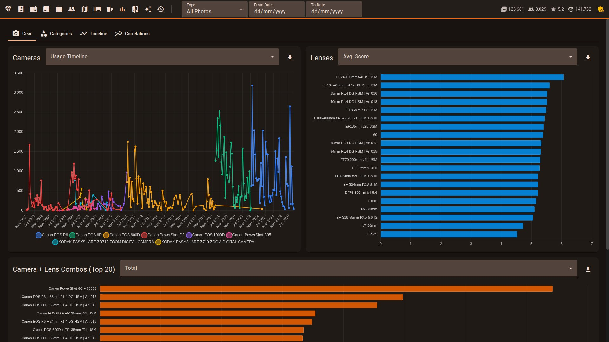</td>
<td>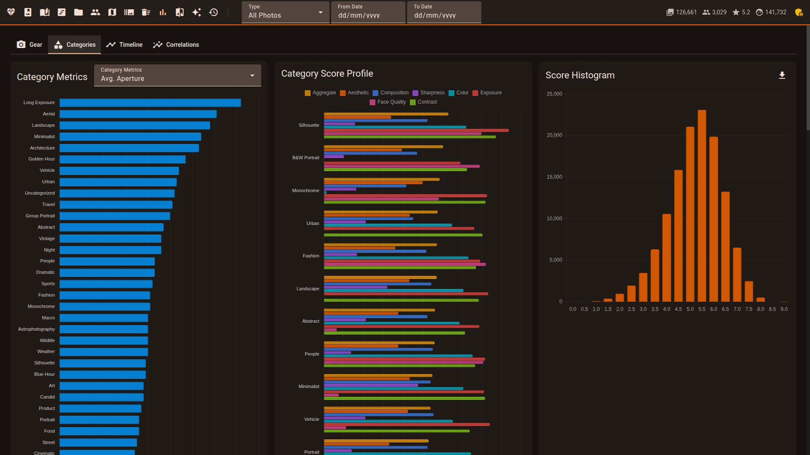</td>
</tr></table>

<table><tr>
<td>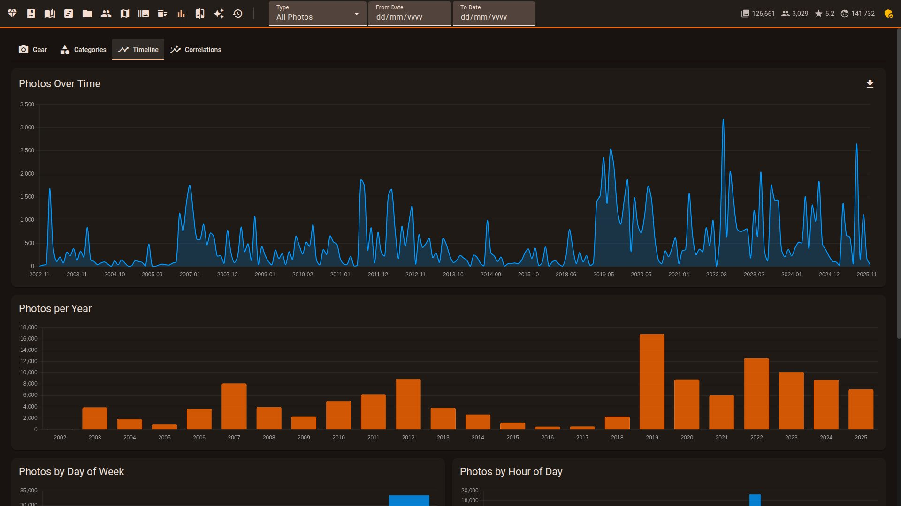</td>
<td>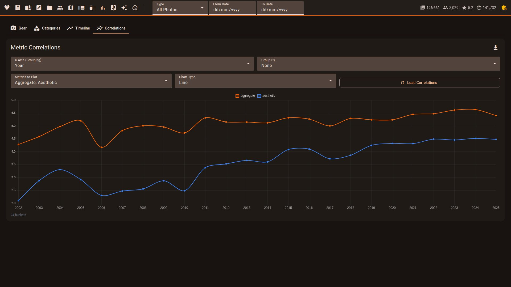</td>
</tr></table>

<table><tr>
<td>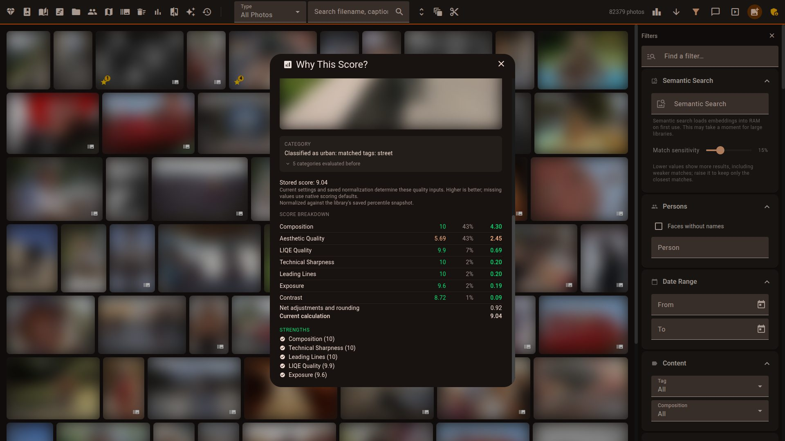</td>
<td>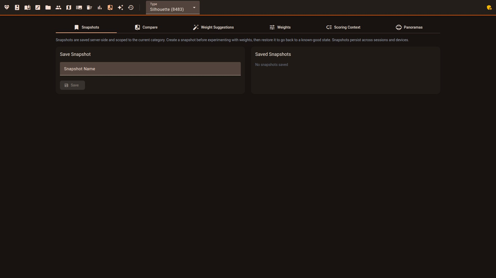</td>
</tr></table>

<table><tr>
<td>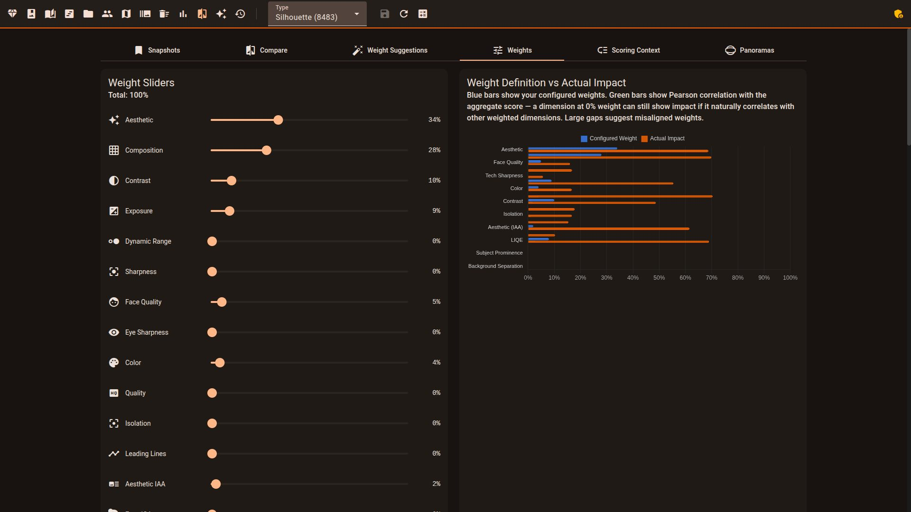</td>
<td>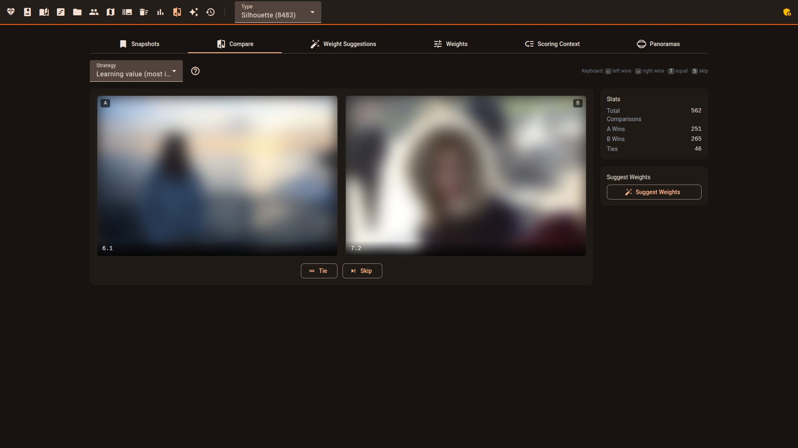</td>
</tr></table>

### Condividere

- **Condivisione di album** — genera link condivisibili per qualsiasi album, senza richiedere l'accesso ai destinatari. Revoca l'accesso in qualsiasi momento.
- **Revisione con il cliente** — un album condiviso può funzionare in modalità di revisione: i clienti mettono il cuore alle foto e lasciano commenti con il solo link (più un PIN facoltativo), del tutto isolati dalle tue valutazioni
- **Caricamento automatico dal telefono** — punta PhotoSync o qualsiasi app WebDAV alla casella `/dav` integrata; `--watch` valuta i nuovi scatti man mano che arrivano
- **Cornici digitali e chioschi** — un endpoint protetto da token fornisce i tuoi scatti migliori selezionati alle cornici digitali intelligenti e ai pannelli di Home Assistant
- **Agenti IA (MCP)** — un endpoint [Model Context Protocol](https://modelcontextprotocol.io/) (attivo per impostazione predefinita, `viewer.mcp.enabled`) permette agli assistenti di cercare nella libreria con token personali revocabili. I livelli di token più alti possono valutare, etichettare, organizzare e selezionare; le azioni distruttive mostrano prima un'anteprima e richiedono conferma
- **Esportazione portfolio** `[Edition]` — renderizza un album in una galleria HTML statica autonoma (nessun riferimento a CDN, funziona offline) da mettere su qualsiasi host web
- **Ritagli per i social** `[Edition]` — esportazioni a piena risoluzione inquadrate sul soggetto rilevato per i preset quadrato, verticale e story
- **Download delle foto** — scarica singole foto o selezioni dalla galleria
- **Esportazione** — esporta tutti i punteggi in CSV o JSON per l'analisi esterna

### Altro

- **Modalità scura e chiara** con 10 temi di colore d'accento; rispetta la preferenza di sistema
- **Reattiva** — si adatta da mobile a desktop, con un pannello di azioni in blocco ottimizzato per il tocco sugli schermi piccoli
- **PWA installabile** — manifest dell'app web + service worker: installa nella schermata principale, shell dell'app offline, miniature memorizzate nella cache
- **Galleria virtualizzata** — renderizza solo una manciata di nodi DOM indipendentemente dalle dimensioni della libreria, così lo scorrimento resta veloce con oltre 100k foto
- **Scansioni riprendibili** — le scansioni interrotte riprendono (`--resume`), i file falliti vengono tracciati e ritentabili (`--retry-failed`), il progresso viene trasmesso all'interfaccia web
- **7 lingue nell'interfaccia** — l'interfaccia è disponibile in inglese, francese, tedesco, spagnolo, italiano, portoghese brasiliano e cinese semplificato (简体中文); la documentazione è disponibile in tutte le sette lingue
- **Multi-utente** — directory, valutazioni e accesso basato sui ruoli per utente
- **Plugin e webhook** — azioni personalizzate attivate dagli eventi di punteggio
- **Scansione dall'interfaccia web** — avvia le scansioni dal browser (superadmin in modalità multiutente; accesso di modifica su un'installazione a utente singolo con password di modifica)

<table><tr>
<td width="33%">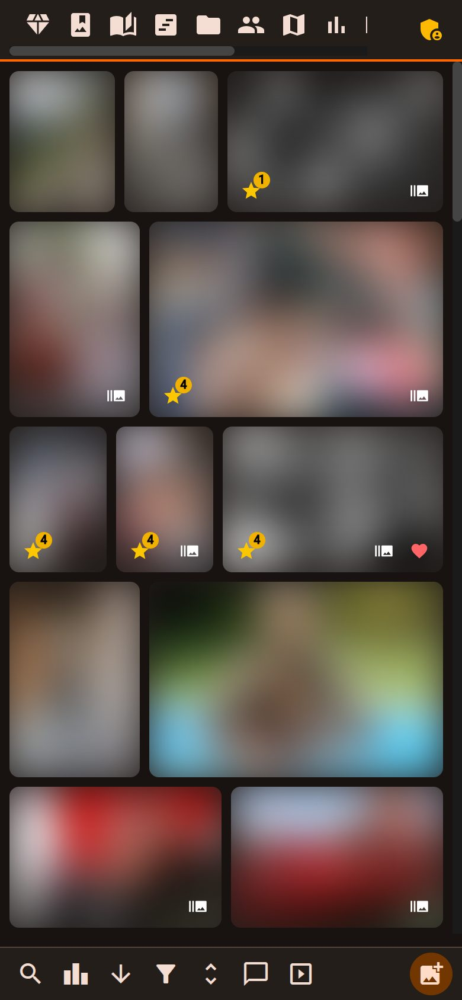</td>
<td width="33%"></td>
<td width="33%">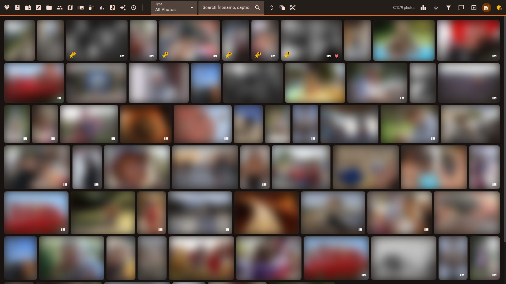</td>
</tr></table>

## Cosa ti serve

- **Qualsiasi macchina (CPU)** esegue la maggior parte di Facet: punteggio, volti, selezione, galleria, ricerca, album ed esportazione dei metadati.
- **Apple Silicon** usa automaticamente il backend Metal (`mps`). Il profilo `auto` segue la memoria unificata: 32 GB arrivano a `16gb`, 48 GB a `24gb`.
- **Una GPU NVIDIA** con i profili `16gb`/`24gb` sblocca i modelli più potenti: TOPIQ, SigLIP 2, tagging VLM, didascalie e critica IA, salienza del soggetto.
- **Niente GPU?** Indirizza il tagging, le didascalie e la critica VLM verso un server **Ollama** o **compatibile OpenAI** remoto con `vlm_backend` in `scoring_config.json`.
- **Le modifiche nel viewer** (valutazioni, volti, selezione) richiedono la **password di modifica**. Il pulsante Scansione richiede `viewer.features.show_scan_button: true` e l'accesso di modifica (il ruolo **superadmin** in modalità multiutente).

→ Requisiti completi per ciascuna funzionalità (GPU, profilo VRAM, pacchetti opzionali, autenticazione): **[Installazione › Requisiti delle funzionalità](docs/it/INSTALLATION.md#requisiti-delle-funzionalità)**.

## Facet fa per te?

Facet assegna punteggi, classifica e seleziona una libreria fotografica locale e serve una galleria per sfogliarla. Funziona sul tuo hardware e mantiene le foto fuori dal cloud.

**Una buona scelta se:**

- hai una grande libreria locale e vuoi trovare i tuoi scatti migliori e selezionare raffiche e quasi-duplicati;
- vuoi un punteggio di qualità, composizione e volti che puoi regolare secondo i tuoi gusti (impara dai tuoi confronti A/B);
- preferisci l'auto-hosting e la privacy — nessun caricamento sul cloud, nessun account, nessun abbonamento;
- già modifichi in Lightroom, darktable, digiKam o Immich — Facet scrive valutazioni, etichette, parole chiave, didascalie e regioni di volti nei sidecar `.xmp` (gli originali restano intatti a meno che tu non chieda l'incorporamento: l'azione "Scrivi metadati nel file" della galleria o `--export-sidecars --embed-originals`) e rilegge le modifiche con `--import-sidecars`. Il plug-in Lightroom `facet.lrplugin` aggiunge un flusso bidirezionale. Vedi [Interoperabilità](docs/it/INTEROP.md).

**Probabilmente non fa per te se vuoi:**

- una sostituzione chiavi in mano, mobile e basata sul cloud di Google Photos — anche se il caricamento automatico dal telefono in una casella osservata è integrato tramite WebDAV (ricetta PhotoSync nella documentazione);
- modifica o sviluppo RAW — Facet assegna punteggi e organizza, non modifica;
- un'app desktop a configurazione zero — richiede Python, e i modelli migliori richiedono una GPU.

**Come si rapporta agli altri strumenti**

- Le librerie self-hosted (Immich, PhotoPrism) si concentrano su organizzazione, ricerca e backup. Facet aggiunge il punteggio di qualità, la classificazione e un flusso di lavoro di selezione che esse non offrono, ma non ha app mobile né backup nel cloud (il caricamento automatico dal telefono via WebDAV è integrato e le valutazioni possono sincronizzarsi con Immich).
- Le app di selezione IA (Aftershoot, Narrative, FilterPixel) sono selezionatori commerciali raffinati, spesso con la modifica integrata. Facet è gratuito, locale, più ampio (galleria, ricerca, volti) e il suo punteggio è regolabile — ma è un progetto di un singolo sviluppatore senza il loro supporto né la modifica RAW.
- Gli editor e i cataloghi (Lightroom, darktable, digiKam) sviluppano e gestiscono le foto. Facet li completa tramite l'interoperabilità dei metadati XMP descritta sopra anziché sostituirli.

Il punteggio estetico è basato su modelli ed è approssimativo; aspettati di dover regolare i pesi per adattarli ai tuoi gusti.

## Avvio rapido

### Docker (consigliato)

```bash
git clone https://github.com/ncoevoet/facet.git && cd facet
cp .env.example .env      # apri .env e imposta PHOTOS_DIR sulla tua cartella foto
docker compose up -d      # poi apri http://localhost:5000
```

Hai una scheda NVIDIA? Usa il blocco per la sua dimensione in
[Installazione](docs/it/INSTALLATION.md#installa-con-docker) — una riga ciascuno per le
schede da 8 GB, 16 GB e 24 GB.

### Senza Docker (Linux, macOS)

```bash
git clone https://github.com/ncoevoet/facet.git && cd facet
bash install.sh                        # rileva il tuo hardware, installa tutto
source venv/bin/activate
python facet.py /path/to/your/photos   # valuta le foto
python viewer.py                       # galleria → http://localhost:5000
```

> **macOS:** AirPlay Receiver di ControlCenter occupa la porta 5000 per impostazione predefinita. Se vedi "Address already in use", esegui `python viewer.py --port 5001`.

Guida completa: **[Installazione](docs/it/INSTALLATION.md)** — configurazione per
hardware, download del primo avvio e [risoluzione dei conflitti di dipendenze](docs/it/INSTALLATION.md#risoluzione-dei-conflitti-di-dipendenze).
Esegui `python facet.py --doctor` per diagnosticare i problemi della GPU.

Prima volta? Segui il percorso **[Per iniziare](docs/it/GETTING_STARTED.md)**: scansione, revisione, addestramento, scarto, tag ed esportazione.

## Documentazione

| Documento | Descrizione |
|----------|-------------|
| [Installazione](docs/it/INSTALLATION.md) | Requisiti, configurazione GPU, profili VRAM, dipendenze |
| [Per iniziare](docs/it/GETTING_STARTED.md) | Percorso del primo avvio: dall'installazione a scansione, revisione, addestramento, scarto, tag ed esportazione |
| [Comandi](docs/it/COMMANDS.md) | Riferimento di tutti i comandi CLI |
| [Configurazione](docs/it/CONFIGURATION.md) | Riferimento completo di `scoring_config.json` |
| [Punteggio](docs/it/SCORING.md) | Categorie, pesi, guida alla regolazione |
| [Riconoscimento facciale](docs/it/FACE_RECOGNITION.md) | Flusso di lavoro dei volti, clustering, gestione delle persone |
| [Viewer](docs/it/VIEWER.md) | Funzionalità e utilizzo della galleria web |
| [API](docs/API.md) | Riferimento dell'API HTTP del viewer |
| [Interoperabilità](docs/it/INTEROP.md) | Scambiare valutazioni/tag con Lightroom, Capture One, digiKam, darktable |
| [Immich](docs/it/IMMICH.md) | Sincronizzare valutazioni e preferiti con Immich, più il webhook in entrata |
| [Ricollegare](docs/it/RELINK.md) | Ricollegare foto spostate |
| [Agenti IA](docs/it/AGENTS.md) | Far cercare la libreria a un assistente compatibile con MCP con un token personale |
| [Distribuzione](docs/it/DEPLOYMENT.md) | Distribuzione in produzione (NAS Synology, Linux, Docker) |
| [Contribuire](CONTRIBUTING.md) | Configurazione di sviluppo, architettura, stile del codice |

## Licenza

[MIT](LICENSE)

### Licenze

Il codice di Facet è con licenza MIT. Alcuni modelli predefiniti sono **non commerciali**: pyiqa (TOPIQ, LIQE, …) e i pesi di InsightFace. Imposta `licensing.mode: commercial` per usare solo sostituti con licenza permissiva ([Licenze](docs/it/CONFIGURATION.md#licenze), [Modelli di terze parti](docs/it/THIRD_PARTY_MODELS.md)).
